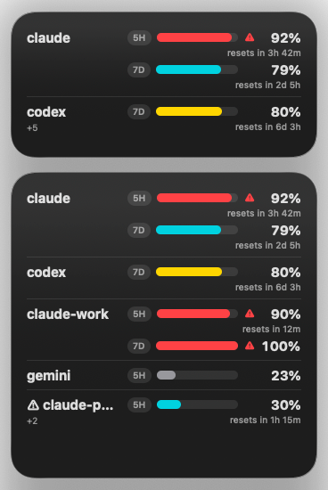

# Agent Usage Monitor

A macOS desktop widget that shows, for every Claude Code and Codex account on one Mac, the 5-hour and 7-day usage limits, when they reset, and whether the account is usable right now. Pick an account before you start work without opening each one.



> **Status:** in development (milestone M1). Installable: the widget shows every Codex and Claude account.

## How it works

```
LaunchAgent (every 5 min) ─┐
widget click ──────────────┴─> AgentUsageMonitor.app ─> agent-usage-monitor collect ─┬─> codex app-server (each run)
                                                                                     └─> claude -p /usage (each run)
                                                                       snapshot.json <─┘
                                                                             │
                                                               desktop widget (WidgetKit)
```

- `agent-usage-monitor collect` (Python 3.9 standard library) reads every account's limits at once, so a stuck CLI holds up only its own account, and writes one snapshot file that the widget displays.
- Codex limits come from `codex app-server` and Claude limits from `claude -p /usage`, every 5 minutes and when you click the widget.
- Each Claude account is a `CLAUDE_CONFIG_DIR`, each Codex account a `CODEX_HOME`.

## Principles

- Only the official `claude` and `codex` CLIs talk to the network: no undocumented endpoints, no reading of credential files or the Keychain, no changes to your Claude or Codex settings.
- Checking usage does not spend quota: in testing, `claude -p /usage` made no model request ([spike report](docs/spikes/TASK-572-claude-usage.md)).
- Known risks of running `claude -p /usage` every 5 minutes:
  - The subscription login is meant for ordinary use of Claude Code ([legal and compliance](https://code.claude.com/docs/en/legal-and-compliance)); an unattended probe every 5 minutes may fall outside it.
  - A future `claude` that sends `-p /usage` to the model as a prompt instead of running the command would spend quota on every run.
- Builds with the Xcode Command Line Tools alone, ad-hoc signed, no Xcode or developer account ([widget spike](spike/clt-widget/README.md)).

## Requirements

- macOS 26 (tested on 26.7.1)
- Xcode Command Line Tools
- `/usr/bin/python3` (3.9)
- `claude` and `codex` on your login shell's `PATH`: `zsh -lc 'command -v claude codex'` prints both. The host app runs `agent-usage-monitor` through `/bin/zsh -l`, a login shell, which reads `~/.zprofile` but not `~/.zshrc`. If the check finds nothing but the CLIs are in `~/.local/bin` (their default install location), `collect` still finds them: it appends `~/.local/bin` to `PATH` when missing. Otherwise move the `PATH` lines from `.zshrc` to `.zprofile`.

## Install

Each step can be rolled back on its own.

| Step | Rollback |
|---|---|
| `git clone git@github.com:ophis/Agent_Usage_Monitor.git ~/.local/share/agent-usage-monitor`, then `make -C ~/.local/share/agent-usage-monitor install`: builds and ad-hoc signs `AgentUsageMonitor.app`, copies it to `~/Applications/AgentUsageMonitor.app`, links `~/.local/bin/agent-usage-monitor`, creates `~/Library/Logs/agent-usage-monitor.log` (0600), writes `~/Library/LaunchAgents/com.ophis.agent-usage-monitor.plist` | `make -C ~/.local/share/agent-usage-monitor uninstall` |
| `launchctl bootstrap gui/$(id -u) ~/Library/LaunchAgents/com.ophis.agent-usage-monitor.plist`: runs `collect` now and every 5 minutes | `launchctl bootout gui/$(id -u)/com.ophis.agent-usage-monitor` |
| Only with accounts outside `~/.claude` and `~/.codex`: write `~/.config/agent-usage-monitor/accounts.json` ([account list](#account-list)) | Delete that file |
| Right-click the desktop › Edit Widgets, search `Agent Usage Monitor`, add the medium or large size | Remove the widget |

`make install` refuses to replace a `~/.local/bin/agent-usage-monitor` that is not its own link. Each rebuild changes the ad-hoc signature: after `make install` again, remove and re-add the widget if it stops updating. `make app` also stamps both bundles' `CFBundleVersion` with the build time, so macOS sees each install as a new build; Apple does not document whether that makes the widget gallery pick up changed sizes. `make install` also stops the running widget extension, matched by its installed path: the old process keeps serving the replaced bundle, so every widget reload fails with `Bundle version did not match` until it exits; macOS starts the new one on the next reload. `make uninstall` runs `launchctl bootout` first, then deletes the app, the link and the plist; delete `~/.local/state/agent-usage-monitor`, `~/.config/agent-usage-monitor` and `~/Library/Logs/agent-usage-monitor.log` yourself.

After `git pull`, run `make install` again: the link makes the new CLI live at once, and it must match the installed host (an older host passes `--probe`, which the current CLI rejects with exit 2).

The widget is a dark card with one group per account, grouped by client ([account list](#account-list)) and separated by thin lines: the client (`claude`, `codex`), then one row per limit (`5H`, `7D`) with a progress bar and the percent, and under the percent when the limit resets (`resets in 12m`, `3h 42m`, `6d 3h`; no line when unknown). The account's `account` string, if set, shows in small grey type at the left of its last reset line, or on a line of its own under the last bar when no limit shows a reset; a long one loses its tail. It shows as many accounts as its size fits; the rest show as `+<k>` under the last one. The bar is teal for Claude, periwinkle for Codex and grey for other clients, yellow from 80% and red from 90%, where a red triangle also precedes the percent; an unknown percent shows an empty bar and `—`, and a limit the account does not have shows no row. The client starts with `⚠` when the account's values are older than 6 hours (`stale`). There is no header line. This layout (TASK-595) replaces the PRD's FR-26 text rows. A click runs `collect` and refreshes the widget within about 30 seconds. With no snapshot it shows `Agent Usage Monitor：没有数据`; click it to collect.

## Development

```sh
make test                  # unit tests with /usr/bin/python3; fake codex and claude only
make pii-scan              # tracked files hold no emails, UUIDs, real home paths or image metadata (NFR-4)
make hooks                 # enable the pre-push hook in this clone (make check also does)
make swift-test            # widget display model self-test
make app                   # build/AgentUsageMonitor.app (swiftc + Command Line Tools, ad-hoc signed)
make check                 # all of the above, then plist lint, signature, widget entitlements and app icon,
                           # and checks the code never names credential files or network APIs
bin/agent-usage-monitor collect     # read every account, write the snapshot (what the LaunchAgent and a widget click run)
```

CI ([`.github/workflows/check.yml`](.github/workflows/check.yml)) runs `make check` on a macOS 26 runner with the Command Line Tools for every pull request and push to `main`.

The repo is public, so personal data is caught before a push: after `make hooks`, [`.githooks/pre-push`](.githooks/pre-push) runs [`tests/pii_scan.py`](tests/pii_scan.py) on the files, commit messages and author and committer emails the push would publish, and refuses the push on a hit. Commit with your GitHub noreply address as `user.email`. A value that may be public goes in [`tests/pii-allowlist.txt`](tests/pii-allowlist.txt) with its reason, with `in:identity` when it may only be a commit author or committer email, and as `sha256:<hex>` of the lowercased value when no file may hold it; explain each new entry in its pull request.

### Account list

`collect` reads the account list `~/.config/agent-usage-monitor/accounts.json` (honors `XDG_CONFIG_HOME`). Without it, the accounts are `~/.claude` (`claude`) and `~/.codex` (`codex`), whichever exist. The snapshot and the widget list accounts by client, Claude then Codex, in file order within each; `threshold` (default 90) is the percent at which an account counts as not available. `name` identifies an account and must be unique; the optional `account`, a non-empty string such as the login email, is only shown in the widget and may repeat across accounts.

To write one, copy [`accounts.example.json`](accounts.example.json) (two Claude accounts, one Codex account) to `~/.config/agent-usage-monitor/accounts.json`, then edit it: set each `dir` to an existing account directory and `account` to your own; drop `account` to show none. JSON has no comments, so the fields are explained here only.

It writes `~/.local/state/agent-usage-monitor/snapshot.json`. Codex limits come from `codex app-server` ([protocol notes](docs/codex-app-server.md)).

Claude limits come from `collect`, which runs `claude -p /usage` for every Claude account in `~/.local/state/agent-usage-monitor/probe/`, with the arguments and environment from the [spike report](docs/spikes/TASK-572-claude-usage.md). The default account (`~/.claude`) runs without `CLAUDE_CONFIG_DIR`; any other account runs with `CLAUDE_CONFIG_DIR=<dir>`. In each such `<dir>`, `claude` itself rewrites `.claude.json` (with a copy under `backups/`) on every probe, syncs the account's plugins and skills under `plugins/synced/` and `skills/synced/` on the first one, and creates an empty `projects/<probe dir>/memory/`; agent-usage-monitor writes nothing there. An account probed less than 4 minutes ago is skipped. If `claude` prints output the parser does not recognize, that account is not probed again until `claude --version` changes; delete `usage_disabled_version` from its snapshot row to retry sooner.

Sources: Python collector in `agent_usage_monitor/`; host app (`macos/Host`, no window, no Dock icon, not sandboxed) and widget (`macos/Widget`, sandboxed, read-only access to `~/.local/state/agent-usage-monitor/` only) in `macos/`.

## Spike conclusions

- **TASK-573** ([report](spike/clt-widget/README.md)): pass. `swiftc` with the Command Line Tools SDK builds an ad-hoc-signed host app and WidgetKit extension that macOS 26.7.1 lists in the widget gallery; the sandboxed widget reads `~/.local/state/agent-usage-monitor/` through a home-relative read-only exception, and a click opens the host app. No Xcode needed.
- **TASK-572** ([report](docs/spikes/TASK-572-claude-usage.md)): pass for Claude Code 2.1.302 and the default account only. `claude -p --no-session-persistence --strict-mcp-config --settings '{"remoteControlAtStartup":false,"disableAllHooks":true}' --model sonnet --effort low /usage` in an empty directory, stdin `/dev/null`, without `ANTHROPIC_*` and `CLAUDE_CODE_OAUTH_TOKEN`, with `DISABLE_AUTOUPDATER=1`, printed the 5h and 7d limits with no model request, no session file, no hook and no MCP server; no session cleanup or status line tap is needed.
- **TASK-583** ([report](docs/spikes/TASK-583-claude-config-dir-usage.md)): pass for non-default accounts with `CLAUDE_CONFIG_DIR` set to the account dir. The default account must keep it unset: set, `claude` looks for a login item named after the dir and reads as logged out. An account with no 5h window running prints `Current session: 0% used` without a reset time, shown as 5h 0%.

## Credits

The Claude `/usage` probe and its output parser are ported from [CodexBar](https://github.com/steipete/CodexBar) (MIT); see [THIRD_PARTY_NOTICES.md](THIRD_PARTY_NOTICES.md).

## License

[MIT](LICENSE) © [Yinze Wang](https://www.linkedin.com/in/yinze-wang/)
